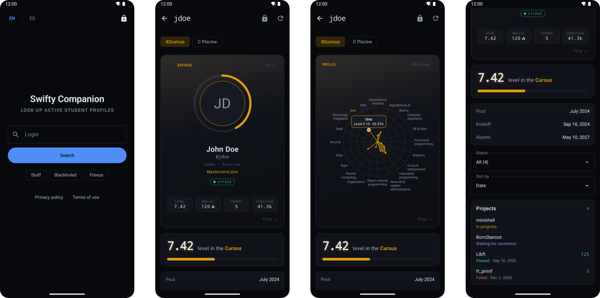
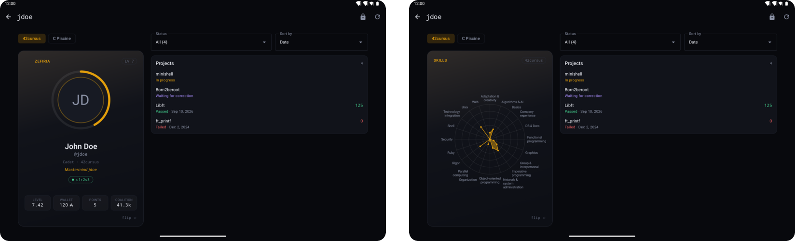

# Swifty Companion

## 📖 About

"Swifty Companion" is a native **Android** app written in **Kotlin** with
**Jetpack Compose** that looks up the profile of a 42 student through the
**42 API v2**. From a login, the app shows who that person is in the
school: photo, level and progress, coalition and score, wallet, correction
points, workstation, skills and every project with its mark.

The profile opens on a card that flips: the front carries the identity and
the numbers, the back a **radar chart of the skills** drawn by hand on a
`Canvas`, where every point and every name can be tapped to read the exact
level. Everything on the screen follows the selected cursus — the main one or
the piscine — and the project list can be filtered by status and sorted by
date, grade or name. On tablets, phones in landscape and unfolded foldables
the screen splits into two panes.

The app is for the 42 community only: before the first search the person
accepts the terms of use and the privacy policy and signs in with their intra
account through **OAuth2 with PKCE**, and only the login is kept. Searches
themselves use the application's own token (client credentials), which is
reused across requests and restarts and renewed before it expires or as soon
as the server rejects it. Requests are spaced to stay under the API's rate
limit, and every failure — invalid login, unknown login, no network, rate
limit, server error — gets its own translated message.

The interface is in **English and Spanish**, switchable inside the app.

<details>
<summary><strong>🖼️ Screenshots</strong></summary>

<br>

<p align="center">
  
</p>

<p align="center"><sub>Search, profile card, skills radar with a tapped skill, and projects. The screenshots use the fake profile of the Compose previews (<code>ui/profile/PreviewProfile.kt</code>), not a real student.</sub></p>

<br>

</details>

## 🎯 Objectives

- Building a native Android app with Kotlin, Jetpack Compose and Material 3
- Calling a REST API that needs OAuth2, with Retrofit, OkHttp and
  kotlinx.serialization
- Managing an access token: storage, reuse across restarts, renewal before
  expiry and after a `401`, never two renewals at once
- Signing a person in with the authorization code flow, `state` and PKCE,
  through a Custom Tab and a deep link back into the app
- Handling every error case of the network and of the API with a clear message
  instead of a crash
- Respecting the API's rate limit
- Drawing custom graphics (level ring, skills radar, wallet sign) on a
  `Canvas`, with tap handling on the same geometry
- Adapting one set of composables to phones, landscape and tablets
- Keeping the screen state across rotations, layout changes and process death
- Testing the network layer against a local fake of the API

## 📋 Function Overview

<details>
<summary><strong>Swifty Companion — modules breakdown</strong></summary>

<br>

| Module | Feature | Description |
|--------|---------|-------------|
| **model** | Profile | Plain Kotlin models: user, cursus, skills, projects, coalition, profile kind |
| **model** | Login | Validation of the typed login before any request |
| **model** | Profile kind | Staff, alumni, not started, blackholed, on freeze, transcender or student, decided from the user and the main cursus |
| **model** | AppError | One typed error per failure, each with its own translated message |
| **data** | UserRepository | Fetches the user, classifies the profile, stops there if it is hidden, then fetches the coalitions and the user's score in the main one |
| **data** | ProfileMapper | JSON to model: project status, order, the four main cursus coalitions, alumni deadline |
| **data** | Preferences | Search options (Staff, Blackholed, Freeze) and the project filter and order of each group of profiles |
| **data/auth** | TokenManager | App token in memory and in private preferences, reused until one minute before it expires |
| **data/auth** | AuthInterceptor | Adds the token to every request and renews it when it is about to expire |
| **data/auth** | TokenAuthenticator | Renews the token and replays the request once when the server answers `401` |
| **data/auth** | SessionManager | Intra sign-in: authorize address with `state` and PKCE, code exchange, `/v2/me`, sign-out |
| **data/net** | IntraApi | Retrofit interface of the endpoints used, kotlinx.serialization DTOs |
| **data/net** | RateLimit | Requests spaced under 2 per second; a `429` is retried after the delay the server asks for |
| **ui/search** | Search screen | Login field, search options, consent dialog, sign-in, account menu, language switch |
| **ui/profile** | Profile screen | Cursus selector, card, level panel, details, projects; one column or two panes |
| **ui/profile/card** | Card | Front and back, flip animation, level ring, skills radar, wallet sign |
| **ui/legal** | Legal texts | Terms of use and privacy policy, in English and Spanish |
| **ui/debug** | Token inspector | Debug builds only: token fingerprint, time left, request counts, expire / corrupt buttons |

<br>

</details>

<details>
<summary><strong>Usage Example & Testing</strong></summary>

### Configure and run

```bash
cp .env.example .env   # fill in INTRA_CLIENT_ID and INTRA_CLIENT_SECRET
make install           # checks the JDK, the Android SDK and .env; builds nothing
make apk               # builds the debug APK
make run               # builds, installs and opens it on the running emulator or device
make test              # unit tests on the JVM
make lint              # static checks
```

The `android/` folder (not the repository root) also opens in Android Studio,
where the `app` configuration runs once Gradle has synced.

### A search

1. A login typed in the field is searched with **Search** or the keyboard's
   search key. `EN | ES` at the top left switches the language; the **Staff**,
   **Blackholed** and **Freeze** chips under the button also let those profiles
   through.
2. The first search asks to accept the terms of use and the privacy policy and
   to sign in with 42 in the page that opens; the search then runs on its own.
   The login at the top right signs out.
3. The profile opens if the login exists and belongs to an active student or
   an alumnus. The refresh icon reloads it.
4. A tap on the card turns it to the skills radar; a tap on a point or a skill
   name shows its level and percentage. The chips above the card choose the
   cursus.
5. The projects follow below (on the right on wide screens). **Status**
   filters them, **Sort by** orders them.

### Errors

Every failure is a typed `AppError` shown under the search field, with a retry
button when retrying can help. The English messages:

| Case | Message |
|---|---|
| Empty field | Type a login |
| Malformed login | A login only has lowercase letters, digits, hyphens and underscores |
| Unknown login | No user with login `jdoe` |
| Not started | `jdoe` has not started the cursus yet. Piscine profiles are not shown. |
| Staff, freeze, blackholed | `jdoe` is staff. Turn on Staff below to see staff profiles. (and the same for Freeze and Blackholed) |
| No network | No connection. Check your network and try again. |
| `429` | Too many requests. Wait a moment and try again. |
| No credentials in the build | API credentials are missing. Add them to .env and rebuild. |
| `401` on the app token | The API rejected the credentials. Check the secret in .env. |
| `5xx` | The server returned an error (503). Try again later. |
| Sign-in closed | Sign-in was cancelled. Search again to sign in. |

### Tests

`make test` runs 79 unit tests in 13 classes on the JVM. The network tests
use a local HTTP server that imitates the token, `/v2/me` and user endpoints,
so they go through the real OkHttp and Retrofit stack without touching the
API. They cover:

- token reuse, reuse after a restart, renewal before expiry, renewal and replay
  after a `401`, rejected credentials, an unreadable token answer and both
  inspector actions;
- error mapping (`404`, `429`, `5xx`, malformed JSON, no connection) and hidden
  profiles without extra requests;
- the coalition kept, the user's score in it (also when that call fails) and
  the compact score format;
- the alumni deadline, the profile kind rules, JSON to model mapping, cursus
  selection, the chart axes, the project filter and sort orders, login
  validation;
- the sign-in: authorize address (state, PKCE challenge checked against the
  RFC 7636 example), code exchange, a forged `state`, refused sign-ins, repeated
  redirects, sign-out, new terms versions, and a sign-in that survives Android
  killing the app;
- state restored after process death: search text, selected cursus, card side,
  project filter and order, search options.

<br>

</details>

## 🚀 Installation & Structure

<details>
<summary><strong>📥 Setup & Usage</strong></summary>

<br>

### Host requirements

| Tool | Needed for | Notes |
|------|------------|-------|
| Android Studio 2026.1+ | Building and running | Android Gradle Plugin 9.4.1, Gradle 9.7.1 through the wrapper |
| Android SDK Platform 37 | Compiling | Android Studio offers it on the first sync |
| JDK 25 | Gradle | Bundled with Android Studio; from a terminal the wrapper downloads one if missing |
| Android 8.0 (API 26)+ | Running | An emulator or a device |
| A 42 API application | Credentials | Created at <https://profile.intra.42.fr/oauth/applications> |

### Credentials

The API credentials are read from a `.env` file at the repository root (next
to `.env.example`, not inside `android/`), which is ignored by git:

```
INTRA_CLIENT_ID=u-s4t2ud-...
INTRA_CLIENT_SECRET=s-s4t2ud-...
```

The application page on the intra must also list this redirect URI, where the
intra sends the person back after signing in:

```
com.ravazque.swiftycompanion://oauth
```

The values are compiled into the build through `BuildConfig`, so rebuild after
changing them. Without them the build still succeeds and the app explains what
is wrong when a search is made. Application secrets expire periodically; when
searches fail with "The API rejected the credentials", copy the current secret
from the application page.

### Profile kinds

The API has no single field that says whether someone is a student, so the app
decides from the user and their main cursus (`42cursus`), in this order:

| Kind | Rule | Shown |
|------|------|-------|
| Staff | `staff?` is true | With the Staff option, tagged "Staff" |
| Alumni | `alumni?` is true or the main cursus grade is "Alumni" | Yes, tagged "Alumni" |
| Not started | No main cursus, or its kickoff (`begin_at`) is still to come | No |
| Blackholed | The main cursus has ended (`end_at` has passed) | With the Blackholed option, tagged "Blackholed" |
| On freeze | The account is inactive (`active?` is false) while the main cursus is open | With the Freeze option, tagged "Freeze" |
| Transcender | Main cursus grade "Transcender" | Yes |
| Student | Anyone else in the main cursus | Yes |

A past black hole date alone does not make a student blackholed: many active
students keep one without their cursus being closed.

### Alumni deadline

A Transcender has eight months from the last time they gained experience to
become alumni. The app takes the date the latest passed project of the main
cursus was graded, adds eight months and shows that date in the details. While
a "Work Experience I" or "Work Experience II" project is open, the count is
paused and the row says "PAUSED".

### Token inspector

Debug builds show a lock icon at the top of both screens. It opens the token
inspector: the first and last four characters of the token, the time left, the
API and token requests made since the app started, the last renewal and its
cause, and two buttons — **Expire now** and **Corrupt token** — that exercise
the renewal before expiry and the renewal after a `401`. Logcat's `SwiftyAuth`
tag shows when the token is reused or renewed; the token itself is never
logged.

<br>

</details>

<details>
<summary><strong>📁 Project Structure</strong></summary>

<br>

```
swifty-companion/
│
├── README.md                                            # Main project documentation
├── Makefile                                             # install (checks), apk, run, test, lint, clean
├── .env.example                                         # Template for the API credentials (copy to .env)
├── .gitignore                                           # .env, Gradle and build output, IDE files
│
├── docs/
│   ├── README.md                                        # Condensed project documentation
│   └── img/
│       ├── phone.png                                    # Search, card, radar and projects on a phone
│       └── tablet.png                                   # The two-pane profile on a tablet, front and back of the card
│
└── android/                                             # The Android project: open this folder in Android Studio
    ├── settings.gradle.kts, build.gradle.kts            # Gradle setup
    ├── gradle/                                          # Wrapper, version catalog, daemon JVM
    │
    └── app/
        ├── build.gradle.kts                             # App module; reads ../.env into BuildConfig
        │
        └── src/
            ├── main/
            │   ├── AndroidManifest.xml                  # Activity, deep link for the sign-in redirect
            │   ├── res/                                 # Strings (en, es), theme, launcher icon, locales
            │   │
            │   └── java/com/ravazque/swiftycompanion/
            │       ├── SwiftyApp.kt                     # Application: owns the AppContainer
            │       ├── AppContainer.kt                  # Dependencies wired by hand
            │       ├── MainActivity.kt                  # Compose host, sign-in redirect
            │       │
            │       ├── model/                           # Profile, ProfileKind, AppError, Login
            │       │
            │       ├── data/
            │       │   ├── UserRepository.kt            # Requests and profile classification
            │       │   ├── ProfileMapper.kt             # JSON to model
            │       │   ├── ProjectViewStore.kt          # Project filter and order per profile group
            │       │   ├── VisibilityStore.kt           # Staff, Blackholed, Freeze options
            │       │   ├── auth/                        # Token, TokenManager, AuthInterceptor, TokenAuthenticator, SessionManager, CdnAuthInterceptor
            │       │   └── net/                         # IntraApi, DTOs, ApiClient, RateLimitInterceptor
            │       │
            │       └── ui/
            │           ├── AppNavHost.kt                # Search, profile and legal destinations
            │           ├── theme/                       # Colours and Material theme
            │           ├── components/                  # Error panel, language switch
            │           ├── search/                      # Search screen, view model, sign-in dialog
            │           ├── profile/                     # Profile screen, view model, sections, projects
            │           │   └── card/                    # Card faces, flip, level ring, skills radar, wallet sign
            │           ├── legal/                       # Terms of use and privacy policy
            │           └── debug/                       # Token inspector (debug builds only)
            │
            └── test/                                    # Unit tests and FakeIntra, a local fake of the API
```

<br>

</details>

<details>
<summary><strong>🧱 Architecture Overview</strong></summary>

<br>

### Layers

```
Compose screen ──observes── StateFlow ── ViewModel ── UserRepository ── Retrofit / OkHttp ── 42 API v2
      │                                     │                                 │
      └── actions (search, flip, filter) ───┘          AuthInterceptor, TokenAuthenticator, RateLimitInterceptor
```

**MVVM**: every screen observes a `StateFlow` from its ViewModel; the ViewModel
calls `UserRepository`, which maps the JSON into plain Kotlin models.
Dependencies are wired by hand in `AppContainer`. The search screen validates
the login, fetches the profile and only then opens the profile screen, so the
profile view never shows an unknown login and every search error appears next
to the text field.

### Two kinds of token

```
sign-in   Custom Tab → intra authorize (state, PKCE) → com.ravazque.swiftycompanion://oauth
          → code exchange → /v2/me → keep the login, drop the token
search    client credentials token → reused until 1 min before expiry → renewed on 401, request replayed once
photos    the same token, added by the image loader to cdn.intra.42.fr/users/... requests only
```

The person's token is used once, to read their login, and dropped: only the
login, the accepted terms version and its date are stored. The `state` and the
PKCE verifier are saved before the browser opens, so the sign-in also completes
if Android killed the app in the meantime. This keeps the app for people with a
42 account; it is not a security barrier, since the application secret is
inside the APK. Renewal of the app token is synchronized, so concurrent
requests never ask for two tokens.

The intra CDN serves profile photos only to requests that carry an API
token, while coalition logos stay public. Coil therefore loads images through
its own OkHttp client, whose `CdnAuthInterceptor` adds the app token to photo
requests on `cdn.intra.42.fr` and to nothing else. Photos stored as GIF are
shown as a still image of their first frame.

### Errors and rate limit

Every failure becomes a typed `AppError` with its own translated message.
Token request failures are raised as `IOException`s, the only kind OkHttp
reports from inside an interceptor, so not even an unreadable token answer can
crash the app. Requests are spaced to stay under 2 per second, and a `429` is
retried after the delay in its answer.

### Hidden profiles cost one request

```
GET /v2/users/:login ── classify ── hidden? ── stop (1 request)
                                      └─ visible ── coalitions ── coalitions_users (score)
```

If either of the coalition calls fails the profile still shows, without the
coalition or without the score.

### The card

Every size inside the card is a multiple of one unit (card width / 32), so it
scales as one piece; its text ignores the system font scale to keep the
proportions, while the rest of the app follows it. The card turns around its
vertical axis in a graphics layer; past 90 degrees the back is drawn with a
half turn of its own so it does not read mirrored.

The radar is drawn on a `Canvas` with a `TextMeasurer`: its radius is the
largest one that keeps every label inside the card, overlapping labels are
moved apart, and the same geometry answers taps — a tap on a name or close to a
point opens a bubble above it (below if there is no room). The main cursus
always shows its 20 axes and the piscine its 6, on the intra's 0–21 scale.

### Layout and state

```
width < 600 dp    one LazyColumn: card, level, details, projects
width ≥ 600 dp    left pane 300–440 dp (card, level, details) │ projects ≤ 720 dp, both centered
```
<br>

<p align="center">
  
</p>

<br>

`ProfileScreen` measures its space with `BoxWithConstraints`; both layouts
share the same composables. The selected cursus and the card side live in the
ViewModel and its `SavedStateHandle`, which Android restores after closing the
app in the background; the project filter and order are saved per group of
profiles. Since none of them live in the composables, switching between one and
two panes keeps them.

### Language

On Android 13 and newer the `EN | ES` switch sets the app language through the
system's `LocaleManager`, so it matches the app language in the system
settings; on older versions the choice is kept in preferences and applied when
the activity starts. Every language ships in the base APK, since the app
changes it at runtime.

<br>

</details>

<details>
<summary><strong>📱 Bonus</strong></summary>

<br>

### Token renewal at expiry

The application token is never requested per search: `TokenManager` keeps it
in memory and in the app's private preferences, so it survives restarts, and
renews it one minute before it expires. If the server still answers `401`,
`TokenAuthenticator` renews it and replays the request once, so the search
still succeeds. Renewal is synchronized, so concurrent requests never ask for
two tokens.

Debug builds show the token inspector (lock icon at the top of both screens)
to exercise both paths by hand:

| Button | Effect | What happens next |
|---|---|---|
| **Expire now** | Marks the stored token as expired | The next request asks for a token first |
| **Corrupt token** | Replaces it with an invalid one | The next request gets a `401`, the app renews and replays it, the profile still loads |

Logcat's `SwiftyAuth` tag shows every reuse and renewal; the token itself is
never logged. `TokenFlowTest` covers reuse, reuse after a restart, renewal
before expiry, renewal and replay after a `401`, a replay rejected again, and
both inspector actions.

<br>

</details>

## 💡 Key Learning Outcomes

- **Declarative UI**: Compose state, recomposition, `LazyColumn`, custom layouts
  and `Canvas` drawing with hit-testing on the same geometry
- **OAuth2 in practice**: client credentials for the app, authorization code
  with `state` and PKCE for the person, and the difference between the two
- **Resilient networking**: interceptors and authenticators, one renewal for
  many concurrent requests, rate limiting, and every failure mapped to a message
- **Android lifecycle**: configuration changes, process death, `SavedStateHandle`
  and deep links into a `singleTask` activity
- **Adaptive layouts**: the same composables arranged for phones, landscape,
  tablets and foldables
- **Modelling an API that does not say what you need**: deciding staff,
  alumni, blackholed or on freeze from indirect fields
- **Testing against a fake server**: the real HTTP stack, a predictable API

## ⚙️ Technical Specifications

- **Language**: Kotlin 2.4, Jetpack Compose (BOM 2026.09), Material 3
- **Android**: minSdk 26 (Android 8.0), targetSdk 36, compileSdk 37
- **Build**: Android Gradle Plugin 9.4.1, Gradle 9.7.1 wrapper, JDK 25
- **Networking**: Retrofit 3, OkHttp 5, kotlinx.serialization; Coil 3 with an
  SVG decoder for coalition logos, profile photos loaded with the app token
- **Auth**: OAuth2 client credentials for searches; authorization code with
  `state` and PKCE through a Custom Tab for the sign-in
- **Token**: kept in memory and private preferences, renewed 1 minute before
  expiry or after a `401`, one renewal at a time
- **Rate limit**: under 2 requests per second, `429` retried after the delay
  the server asks for
- **Architecture**: MVVM with `StateFlow`, dependencies wired by hand
- **Layouts**: one column below 600 dp, two panes from 600 dp
- **Languages**: English and Spanish, switched at runtime
- **Tests**: 79 JVM unit tests with JUnit 4, kotlinx-coroutines-test and
  OkHttp's MockWebServer as a fake of the API

## 🔧 Requirements

- Android Studio 2026.1 or newer, or the Android SDK with platform 37 and a JDK 25
- An emulator or a device running Android 8.0 (API 26) or newer
- A 42 API application, with its UID and SECRET in `.env` and
  `com.ravazque.swiftycompanion://oauth` as a redirect URI
- A 42 intra account to sign in

---

> [!NOTE]
> Swifty Companion is a small app with the problems of a large one: two OAuth2
> flows, a token that has to survive restarts and races, an API that is rate
> limited and does not say who is a student, and a single screen that has to
> look right from a small phone to a tablet.
